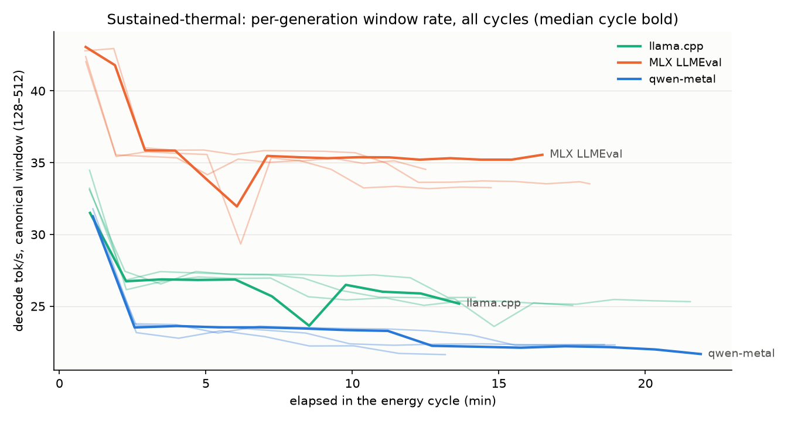
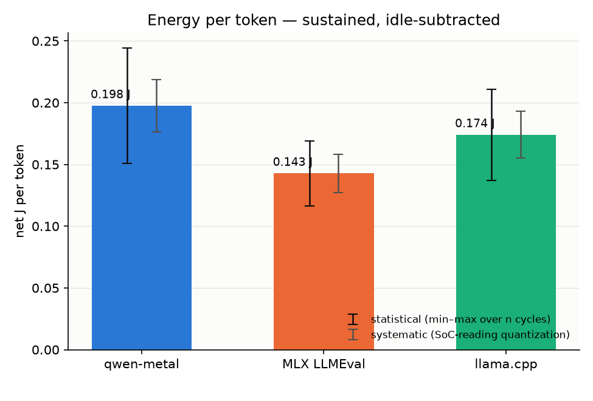
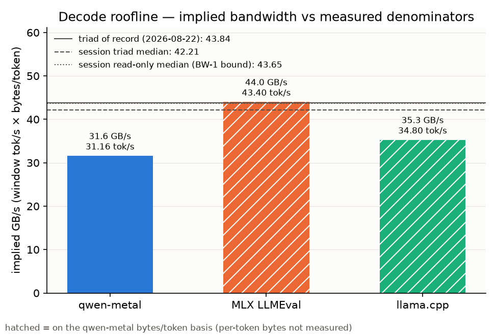

# qwen-metal — the Phase 6 benchmark writeup

A from-scratch Swift + Metal inference engine for Qwen3-1.7B (4-bit, group
64) on an iPhone 15 Pro, measured head-to-head against MLX Swift (LLMEval)
and llama.cpp (llama.swiftui) in one session, on one iOS build, with one
metric definition per metric. This document is what the project is defined
by: a working engine plus a quantified comparison — prefill tok/s, decode
tok/s, peak memory and energy per token for all three engines — with a
roofline analysis that explains every gap and a limitations section that
says what the numbers cannot support. Written 2026-10-16 (task P6-6, spec
docs/phases/phase-6.md D8).

**How to read the numbers.** Three provenance classes, and every number in
this document belongs to exactly one:

1. **Regenerated Phase 6 numbers** — every table between a
   `<!-- phase6:table N -->` marker and its closing marker is the verbatim
   output of `tools/phase6_analyze.py` run over the raw exports archived
   under `benchmarks/phase6/` (`docs/writeup/tables.md`, `summary.json`,
   the three figures). Nothing in those blocks is typed by hand;
   `tests/test_writeup.py` fails if a block drifts from a fresh
   regeneration or if an inline headline number disagrees with
   `summary.json`.
2. **Ledger-cited history** — Phase 0 to Phase 5 numbers carry the date of
   the DECISIONS.md entry or the benchmarks/results.md row they come from
   and are labeled PROVISIONAL where the ledger labels them so.
3. **Derived arithmetic** — a handful of ratios shown inline always name
   both inputs; the writeup test recomputes each one from the archive.

Device: iPhone 15 Pro (iPhone16,1, A17 Pro, 8 GB), iOS 26.6.1 on every row,
Xcode 26.6 (17F113), Metal API validation OFF, detached (home-screen)
launches, greedy sampling, non-thinking template, the pinned prompt set.
Engine build of record: tag `phase6-build` (commit 17cd19c), frozen before
the first device row with its full correctness evidence re-run green
(DECISIONS.md 2026-09-27). Sessions: speed `phase6-speed-2026-09-28`
(2026-09-27 EST), energy `phase6-energy-2026-10-12` (cycles 2026-10-12 to
2026-10-15, idle baseline 2026-09-29/30).

## Summary

- **Decode (warm burst, canonical window 128–512):** qwen-metal 31.16
  tok/s vs MLX 43.40 vs llama.cpp 34.80. The committed success metric
  (ours ÷ MLX ≥ 0.75, same session, same definition) reads **0.718 ⇒ NOT
  MET**. The Phase 0 planning constant derived from it (29.4 tok/s = 0.75 ×
  MLX's PROVISIONAL 39.2) is exceeded; the same-session MLX window rate is
  43.40, not 39.2 (§2, §7).
- **Prefill (852-token prompt, first-token span):** 232.63 vs 387.60 vs
  440.71 tok/s — 60% of MLX, 53% of llama.cpp. One owner: the tiled
  dequant-GEMM's compute plateau on the A17 Pro (§5, §6).
- **Sustained (5-min regenerate loops, second-half plateau):** 22.83 vs
  34.94 vs 27.41 tok/s. MLX's throttled plateau is above our unthrottled
  burst rate.
- **Memory (phys_footprint, Xcode gauge):** 574.9 MB mmap / 1.46 GB wired
  (the honest resident total) vs MLX 1.07 GB vs llama.cpp 560.9 MB (its
  GGUF pages are file-backed and excluded, like our mmap row).
- **Energy (sustained, battery-delta, idle-subtracted, n=4 each):** 0.1975
  vs 0.1428 vs 0.1740 net J/token. MLX is lowest; ours and llama.cpp
  overlap within spread. The round's dominant limitation is that the
  80→70% start anchor was waived by decision (§4, §7).
- **Where the gaps live (measured, §5–§6):** decode is bandwidth
  utilization — our weight stream runs at ≈80% of the measured 43.84 GB/s
  roofline (implied 31.60 GB/s end-to-end, 0.749 of the session triad)
  while MLX's rate implies ≈1.04 × the triad on the same byte basis; the
  named levers are the matvec stream rate and the ≈1.4 ms/token submission
  overhead (PIPE-1). Prefill is compute — the layer GEMMs run at 0.77
  TFLOPS, the kernel's own plateau, against ≥1.09 TFLOPS implied by MLX's
  span on the same silicon (GE-1).

## 1. Headline table

All three engines, one session (speed), one iOS build, interleaved in
rotating order with our warm-burst bookends opening and closing the session
(bookend delta +0.05 tok/s — the smallest cross-engine effect below, 3.64
tok/s between llama.cpp and ours, exceeds it by more than 70×). Definitions (spec D1, identical on every
engine): decode tok/s = 384 ÷ (t₅₁₂ − t₁₂₈) on host wall time at which
generated token k is available; prefill tok/s = per-engine prompt token
count ÷ the span from prompt-processing start to the first generated token
id being available (no decode forward inside the span — verified for each
harness at P6-2); sustained plateau = median of the second half of a 5-min
regenerate loop's per-generation window rates; phys_footprint = the Xcode
memory gauge on an attached footprint-only launch after the timed rows;
net J/token from the energy round (§4). Cold = the first launch of that app
in the session (weights from disk); warm = every later row. The token
counts are per-engine as pinned: 852 on every engine for prefill-summarize;
84 for decode-essay on every engine this session (MLX in rendered-input
mode with the exact-count parity signature on every row; llama.cpp's own
tokenizer also read 84 — the DECISIONS.md 2026-09-27 note on the harness's
"92 on record").

<!-- phase6:table 1 -->
| engine | decode tok/s, warm burst (window median, n) | decode tok/s, cold (window) | prefill tok/s, warm (span median, n, tokens) | sustained plateau (2nd-half median) | phys_footprint (Xcode gauge) | net J/token (mean, n) |
|---|---|---|---|---|---|---|
| qwen-metal | 31.16 (n=5) | 31.35 | 232.63 (n=3, 852 tok) | 22.83 | ours-mmap 574.9 MB, ours-wired 1460.0 MB | 0.1975 (n=4) |
| MLX LLMEval | 43.40 (n=3) | 43.38 | 387.60 (n=3, 852 tok) | 34.94 | mlx 1070.0 MB | 0.1428 (n=4) |
| llama.cpp | 34.80 (n=3) | 34.66 | 440.71 (n=3, 852 tok) | 27.41 | llama 560.9 MB | 0.1740 (n=4) |
<!-- /phase6:table -->

Reading the table:

- **Burst vs sustained are different regimes** and are never compared
  across engines without matching: the burst rows are ≈20 s generations
  from rest; the sustained column is the plateau after the first thermal
  step of a 5-min loop (§3).
- **Cold ≈ warm on every engine** because the window (tokens 128–512)
  excludes model load and the prompt forward; cold start costs land in
  time-to-first-token, which this table does not headline.
- **Our n=5** counts the two bookends as warm rows (they are protocol
  rows of the same definition); the external engines have n=3 warm rows
  each. Prefill is n=3 on every engine. Our first prefill row carried the
  tiled path's first-use cost in wall (179.79 tok/s with a 4.74 s wall
  over a 3.24 s GPU span); the median row is the number of record.
- **phys_footprint is not one accounting basis across engines.** Our
  mmap row and llama.cpp's row both exclude clean file-backed weight
  pages; our wired-copy row (1.46 GB) is the honest resident total for
  this model at 4-bit with a preallocated 4K fp16 KV cache. MLX's weights
  are dirty buffer memory, so its gauge is a resident total. See §7.
- The energy column is the §4 headline (n=4 cycles each, any-start rule).

## 2. Success-metric verdict

PLAN.md's success metric: our decode tok/s ≥ 0.75 × MLX's measured decode
tok/s, both in the same session, on the same device, at the canonical
window. Until this round the metric had never been evaluated as written —
the Phase 0 MLX number (39.2 tok/s, 2026-08-22) was an app-reported
overall rate on iOS 26.5.2 with Metal API validation ON, from which the
29.4 tok/s planning constant was committed. This session produced the
same-definition MLX number.

<!-- phase6:table 2 -->
ours 31.16 ÷ MLX 43.40 = 0.718 vs ≥ 0.75 ⇒ **NOT MET** (the committed 29.4 tok/s constant reported alongside)
- tripwire decode warm-burst window median ≥ 24: 31.16 ⇒ PASS
- tripwire prefill warm span median ≥ 135: 232.63 ⇒ PASS
- bookend delta (close − open, window tok/s): 0.05
<!-- /phase6:table -->

**Verdict: NOT MET** at 0.718 (formal record at P6-EXEC; it does not block
the phase exit, which turns on this document's completeness). Two things
are true at once and both are stated: the committed 29.4 tok/s constant is
exceeded (31.16; also 31.67 / 31.05 / 30.90 on the Phase 4–5 rows of
2026-09-14, 2026-09-19, 2026-09-23), and the metric as written is missed
because the same-session MLX window rate is 43.40, ≈11% above the Phase 0
overall rate it was planned from. Phase 0's rate was understated for three
named reasons (validation ON, the overall rate including the slow first
tokens and the EOS tail, template feeding) and the OS build moved — all
enumerated in §7. The anatomy of the miss is in §5: on the same
bytes-per-token basis MLX decodes at ≈1.04 × this session's measured
triad bandwidth and we decode at 0.749 of it. The gap is bandwidth
utilization inside the weight-streaming matvec plus the ≈1.4 ms/token
submission overhead, not attention and not elementwise work (§6). Against
llama.cpp the ratio is 31.16 ÷ 34.80 = 0.895.

The two regression tripwires (the Phase 4 and Phase 5 constants reused,
never loosened) pass on the frozen build, which is the evidence that the
Phase 6 harness-only changes lost nothing: decode 31.16 vs 31.67 on
record, prefill 232.63 vs 240.86 on record (2026-09-23), both inside
session-to-session noise.

## 3. Sustained-thermal behavior



The chart of record is the energy round: twelve ≈13–22 min regenerate
loops (four per engine, §4), each plotted as its per-generation canonical
window rate against elapsed time, repeats faint and the median cycle bold.
The speed session's three 5-min loops are the short thermal rows and
reproduce the same plateaus.

<!-- phase6:table 3 -->
| engine | generations | first window tok/s | last window tok/s | 2nd-half median | minutes | elapsed basis |
|---|---|---|---|---|---|---|
| qwen-metal | 4 | 31.37 | 22.83 | 22.83 | 5.0 | text gen lines |
| MLX LLMEval | 5 | 40.53 | 35.10 | 34.94 | 5.1 | text gen lines |
| llama.cpp | 5 | 33.98 | 27.41 | 27.41 | 5.0 | text gen lines |

Energy cycles as thermal runs (D4 — the chart of record, docs/writeup/thermal.png):

| cycle | engine | generations | first window tok/s | last window tok/s | 2nd-half median | minutes | elapsed basis |
|---|---|---|---|---|---|---|---|
| llama-energy-0 | llama.cpp | 12 | 31.50 | 25.18 | 25.79 | 13.9 | text gen lines |
| llama-energy-1 | llama.cpp | 18 | 34.47 | 25.32 | 25.35 | 21.6 | text gen lines |
| llama-energy-2 | llama.cpp | 15 | 33.22 | 25.05 | 25.51 | 17.6 | text gen lines |
| llama-energy-3 | llama.cpp | 12 | 33.12 | 25.61 | 27.04 | 14.2 | text gen lines |
| mlx-energy-0 | MLX LLMEval | 17 | 43.06 | 35.55 | 35.31 | 16.5 | text gen lines |
| mlx-energy-1 | MLX LLMEval | 14 | 42.39 | 33.26 | 33.30 | 14.7 | text gen lines |
| mlx-energy-2 | MLX LLMEval | 13 | 42.03 | 34.53 | 35.12 | 12.7 | text gen lines |
| mlx-energy-3 | MLX LLMEval | 18 | 42.79 | 33.53 | 33.67 | 18.1 | text gen lines |
| ours-energy-0 | qwen-metal | 14 | 31.79 | 22.33 | 23.00 | 18.7 | text gen lines |
| ours-energy-1 | qwen-metal | 10 | 30.87 | 21.63 | 22.23 | 13.2 | text gen lines |
| ours-energy-2 | qwen-metal | 14 | 30.73 | 22.30 | 22.32 | 19.0 | text gen lines |
| ours-energy-3 | qwen-metal | 16 | 31.26 | 21.67 | 22.16 | 22.0 | text gen lines |
<!-- /phase6:table -->

What the chart shows:

- **Every engine takes one thermal step after its first generation and
  then holds a plateau**; there is no slow decline and no bimodality (the
  mmap re-fault signature PLAN.md invariant 3 warned about does not
  appear — our cycles are flat at 22–23 tok/s for 13–22 minutes).
- **The step is engine-specific.** From the first generation to the
  5-min plateau: ours 31.37 → 22.83 (−27%), MLX 40.53 → 34.94 (−14%),
  llama.cpp 33.98 → 27.41 (−19%). Over the longer energy cycles the
  plateaus are the same bands (second-half medians across each engine's
  four cycles): ours 22.2–23.0, MLX 33.3–35.3 and llama.cpp 25.4–27.0
  tok/s; first generation → plateau reads ours −27% to −29%, MLX −16% to
  −21%, llama.cpp −18% to −26%.
- **Our step is the largest** and reproduces the Phase 4 finding (P4-11,
  2026-09-14: ≈23.6 plateau). The engine that streams weights at the
  lowest fraction of the roofline when cool loses the most when the
  device throttles — consistent with the matvec being the component
  that sits closest to the memory system (§6). Attributing the step
  between clock reduction and memory-system behavior needs a counter the
  device does not expose (§7, no temperature readout).
- **MLX's plateau (≈35 tok/s) sits above our burst rate (31.16)**: in the
  sustained regime the decode gap widens from 0.718 to
  22.83 ÷ 34.94 = 0.653.
- Phase 0's PROVISIONAL sustained figures (2026-08-22: MLX −9% and
  llama.cpp −45% over 17.6-min detached cycles; −30% / −34% on attached
  5-min loops) are superseded: this round's detached, same-build cycles
  read −16% to −26% for the external engines. llama.cpp's Phase 0 −45%
  does not reproduce on the P6-2 harness; its cause is not established
  (the OS build, the reset policy and the SoC band all moved — §7).
- x-axis basis: our cycles' elapsed time is the sum of generation walls
  (no JSON timelines were copied this round); the external cycles carry a
  loop-clock stamp per generation. The difference is the inter-generation
  gap of a few hundred milliseconds per generation.

## 4. Energy per token



Protocol (PLAN.md energy protocol, spec D4): detached, airplane mode ON,
minimum brightness, Auto-Lock Never, Background App Refresh off, unplugged,
validation OFF; the engine's regenerate loop on decode-essay runs while
the state of charge drops 10 points (Settings → Battery is the value of
record at the marks; the harness's programmatic reading is a cross-check);
gross energy = ΔSoC × J-per-1%-SoC, where J per 1% = 12.6 Wh × 36 ×
(battery HEALTH ÷ 100) read from Settings at the cycle (453.6 J at the
100% health recorded on every cycle — the 2026-09-05 correction: every
pre-Phase-6 "health" field was in fact state of charge); the idle
baseline, measured once on this iOS build, is scaled pro-rata to the
cycle's wall and subtracted; the table value is net J ÷ generated tokens.
Validity per cycle: ≥8% burned, implied gross watts inside 3–9 W, n ≥ 3
valid cycles per engine; health and SoC recorded as separate fields.

<!-- phase6:table 4 -->
Idle baseline (same iOS build, app foregrounded, no generation): 93→74% over 36000 s at health 100% (453.6 J per 1% SoC) = 0.239 W, scaled pro-rata to each cycle's wall.

| engine | cycle | health % | SoC start→end | ΔSoC | cycle wall s | tokens | gross J | implied W | idle ΔSoC (scaled) | net J | net J/token | valid |
|---|---|---|---|---|---|---|---|---|---|---|---|---|
| qwen-metal | ours-energy-0 | 100 | 99→89 | 10 | 1120 | 23851 | 4536 | 4.05 | 0.59 | 4268 | 0.1789 | VALID (off-band start, any-start rule) |
| qwen-metal | ours-energy-1 | 100 | 61→51 | 10 | 794 | 16517 | 4536 | 5.72 | 0.42 | 4346 | 0.2631 | VALID (off-band start, any-start rule) |
| qwen-metal | ours-energy-2 | 100 | 74→64 | 10 | 1142 | 23859 | 4536 | 3.97 | 0.60 | 4262 | 0.1787 | VALID (off-band start, any-start rule) |
| qwen-metal | ours-energy-3 | 100 | 80→69 | 11 | 1322 | 27591 | 4990 | 3.78 | 0.70 | 4673 | 0.1694 | VALID |
| MLX LLMEval | mlx-energy-0 | 100 | 71→61 | 10 | 991 | 33166 | 4536 | 4.58 | 0.52 | 4299 | 0.1296 | VALID (off-band start, any-start rule) |
| MLX LLMEval | mlx-energy-1 | 100 | 71→61 | 10 | 884 | 28825 | 4536 | 5.13 | 0.47 | 4324 | 0.1500 | VALID (off-band start, any-start rule) |
| MLX LLMEval | mlx-energy-2 | 100 | 60→50 | 10 | 764 | 25277 | 4536 | 5.94 | 0.40 | 4353 | 0.1722 | VALID (off-band start, any-start rule) |
| MLX LLMEval | mlx-energy-3 | 100 | 81→71 | 10 | 1086 | 35852 | 4536 | 4.18 | 0.57 | 4276 | 0.1193 | VALID (off-band start, any-start rule) |
| llama.cpp | llama-energy-0 | 100 | 61→51 | 10 | 834 | 21057 | 4536 | 5.44 | 0.44 | 4336 | 0.2059 | VALID (off-band start, any-start rule) |
| llama.cpp | llama-energy-1 | 100 | 83→73 | 10 | 1295 | 32021 | 4536 | 3.50 | 0.68 | 4226 | 0.1320 | VALID (off-band start, any-start rule) |
| llama.cpp | llama-energy-2 | 100 | 75→65 | 10 | 1057 | 26460 | 4536 | 4.29 | 0.56 | 4283 | 0.1619 | VALID (off-band start, any-start rule) |
| llama.cpp | llama-energy-3 | 100 | 80→70 | 10 | 852 | 22063 | 4536 | 5.33 | 0.45 | 4332 | 0.1964 | VALID |

| engine | n valid | mean net J/token | spread (min–max) | systematic ± | implied W (mean) | status |
|---|---|---|---|---|---|---|
| qwen-metal | 4 | 0.1975 | 0.1694–0.2631 | ±10.7% | 4.38 | headline |
| qwen-metal (in-band subset, start = 80) | 1 | 0.1694 | 0.1694–0.1694 | ±10.1% | 3.78 | pinned-protocol subset (below the ≥3 pin unless n ≥ 3) |
| MLX LLMEval | 4 | 0.1428 | 0.1193–0.1722 | ±10.8% | 4.96 | headline |
| llama.cpp | 4 | 0.1740 | 0.1320–0.2059 | ±10.9% | 4.64 | headline |
| llama.cpp (in-band subset, start = 80) | 1 | 0.1964 | 0.1964–0.1964 | ±10.7% | 5.33 | pinned-protocol subset (below the ≥3 pin unless n ≥ 3) |
<!-- /phase6:table -->

**The two error bars (both drawn in the figure):**

- *Statistical* = the min–max spread over the n=4 cycles: ±24% of the
  mean for ours, ±19% for MLX, ±21% for llama.cpp. It dominates, and it
  is not noise — it tracks the state-of-charge region a cycle ran in.
- *Systematic* = the SoC-reading quantization, ±0.5% per Settings
  reading, propagated through the 10-point burn and the idle term:
  ±10.7–10.9% on every net figure (the ≥4% idle rule bounds the idle
  term's own contribution to under ±3% of net; the 19-point overnight
  baseline makes it far smaller).

**The dominant limitation of the energy row — stated here and in §7.**
The protocol pins an 80→70% band precisely because the iPhone's SoC gauge
is nonlinear across its range. On 2026-10-13 James waived the start anchor
for this round ("any-start" rule, recorded in DECISIONS.md and in the
manifest); the ≥8%-burned and 3–9 W checks still bound every cycle and
every off-band cycle is labeled in the table. The data show the effect
the band exists to remove: each engine's cycle that started at 60–61% is
that engine's highest J/token and highest implied-watts reading (ours
0.2631 at 5.72 W, MLX 0.1722 at 5.94 W, llama.cpp 0.2059 at 5.44 W),
while ours' three cycles started at 74% or above read 0.1694 / 0.1787 /
0.1789 — tight. Round 4 was
the in-band attempt: ours 80→69 (0.1694, a late stop at 11 points), MLX
81→71 (0.1193 — one point above the anchor, so labeled off-band under the
pinned rule although it is the 80-region reading in substance), llama.cpp
80→70 (0.1964). Each is a single cycle, below the ≥3 pin, so they are
cited as pinned-protocol spot readings next to the n=4 means, never as the
headline.

**What can be concluded.** Over all cycles MLX is lowest (0.1428) and
ours (0.1975) and llama.cpp (0.1740) overlap within spread; the mean
ratios are ours ÷ MLX = 1.383 and llama.cpp ÷ MLX = 1.219, and in the
80-region spot readings ours ÷ MLX = 1.42 and llama.cpp ÷ MLX = 1.65. In
tokens per joule the means read 5.06 (ours), 7.00 (MLX) and 5.75
(llama.cpp). Implied gross draw is 3.5–5.9 W on every cycle, inside the
3–9 W anchor; the idle baseline is 0.239 W (the Phase 0 dry run estimated
≈0.50 W from a 1%/15-min reading with ±50% quantization — the overnight
19-point drop is the better measurement). llama.cpp's energy row was
KEPT at n ≥ 3 (the pre-declared cut rule was never exercised). The Phase 0
PROVISIONAL dry-run values on the corrected capacity basis (MLX ≈0.122,
llama.cpp ≈0.154 J/token, n=1 each, 2026-08-22 / 2026-09-05) sit inside
the Phase 6 spreads.

Energy is reported for the sustained regime only — burst energy is
undefined by protocol — and the MLX-vs-ours energy ratio (1.38) is close
to the sustained throughput ratio (34.94 ÷ 22.83 = 1.53) at similar
implied watts, i.e. the engines draw comparable power and differ in how
many tokens they produce per second of it.

## 5. Roofline analysis from measured denominators



### 5.1 Decode: bandwidth

Decode at batch size 1 is memory-bound: every token streams the entire
quantized weight set plus the KV cache at the current depth. The roofline
denominator is measured, never assumed (PLAN.md invariant 1): the 2R+1W
STREAM triad on this device read 43.84 GB/s on 2026-08-22 (the denominator
of record, ≈85.6% of the A17 Pro's rated 51.2 GB/s), and the speed session
re-measured it on the same build alongside the BW-1 read-only variant.

<!-- phase6:table 5 -->
- triad: median of 2 run(s) = 42.21 GB/s; run medians 41.48, 42.94
- read-only: median of 2 run(s) = 43.65 GB/s; run medians 44.55, 42.75
- paired read-only ÷ triad: 1.074, 0.996
<!-- /phase6:table -->

<!-- phase6:table 6 -->
Denominators (all measured): triad of record 43.84 GB/s (DECISIONS.md 2026-08-22); session triad median 42.21 GB/s; session read-only median 43.65 GB/s (the BW-1 bound). bytes/token = weights + 114,688 B × (prompt tokens + 320) of fp16 KV. Sequential-prefill structural ceiling (weights re-streamed per token at the record denominator): 45.30 tok/s.

| engine | window tok/s | bytes/token | basis | implied GB/s | ÷ session triad | ÷ triad of record | ceiling tok/s (record / session) |
|---|---|---|---|---|---|---|---|
| qwen-metal | 31.16 | 1,014,087,680 | measured (qwen-metal packed weights + fp16 KV) | 31.60 | 0.749 | 0.721 | 43.23 / 41.62 |
| MLX LLMEval | 43.40 | 1,014,087,680 | qwen-metal bytes/token basis (this engine's per-token bytes are not measured — labeled) | 44.01 | 1.043 | 1.004 | 43.23 / 41.62 |
| llama.cpp | 34.80 | 1,014,087,680 | qwen-metal bytes/token basis (this engine's per-token bytes are not measured — labeled) | 35.29 | 0.836 | 0.805 | 43.23 / 41.62 |
<!-- /phase6:table -->

Bytes per token for our engine are counted, not estimated: 967,753,728 B
of packed q4g64 weights (every weight matrix including the tied
embedding/lm_head, dequantized in registers inside the consuming kernel —
nothing dequantized is ever written to memory) plus 114,688 B of fp16 KV
per cached position (28 layers × K and V × 8 KV heads × 128 × 2 bytes) at
the window's median depth (84 prompt + 320 generated), plus activations
and logits below 10 MB. That is 1.014 GB per token, so the bandwidth
ceiling at this depth is 43.23 tok/s against the denominator of record
and 41.62 against this session's triad.

- **qwen-metal streams at 0.749 of the session triad (0.721 of the
  record).** The decomposition in §6 locates it: the weight-streaming
  kernels (matvec + head/tail) take 27.46 ms of the 29.07 ms GPU class-sum
  per token, i.e. 967,753,728 B ÷ 27.46 ms = 35.2 GB/s inside the matvec,
  ≈80% of 43.84 — the P4-EXEC finding reproduced on this build — and the
  rest of the token (attention 1.17 ms, elementwise 0.42 ms, ≈1.4 ms of
  wall−GPU submission overhead) dilutes it to the 31.60 GB/s end-to-end
  figure.
- **MLX's 43.40 tok/s implies 44.01 GB/s on our byte basis — 1.043 × the
  session triad and 1.004 × the record.** MLX's 4-bit group-64 affine
  format carries the same 4.5 bits per weight as ours (fp16 scale and bias
  per 64-group), so our byte count is a close proxy for its weights;
  its KV cache is fp16 at the same depth. MLX is at the triad ceiling.
  Whether that means the triad understates read-dominated bandwidth was
  BW-1's question: the Mac answered no (read-only ≈ 0.97 × triad,
  2026-09-26) and the device pair is inconclusive at n=2 (1.074 and 0.996
  — one pair 7% above parity, one at parity; the runbook asked for three
  pairs, two were run). The honest statement is that MLX decodes within a
  few percent of the best bandwidth figure this project can measure on
  the device, and that beating it outright would need near-perfect
  utilization.
- **llama.cpp at 0.836 / 0.805 on the same proxy basis.** Its Q4_K_M
  GGUF is 5.03 bits per weight at the file level (1217.35 MiB, DECISIONS.md
  2026-08-22), so its true streamed bytes per token are likely higher
  than the proxy and its true bandwidth fraction likely higher than 0.84;
  the per-token byte count is not measured by this project, which is why
  the row is labeled rather than corrected.
- **Residual to the ceiling for our engine:** from 31.16 to 43.23 tok/s
  at this depth. The two measured components are the matvec stream rate
  (80% → 100% of the roofline would take the weight-streaming time from
  27.46 to ≈22.1 ms) and the ≈1.4 ms/token submission overhead that
  PIPE-1 removes from the critical path (§6, §8).

### 5.2 Prefill: compute

Prefill is the opposite regime. A sequential prefill that re-streams the
weights once per prompt token is bounded by 43.84 GB/s ÷ 967,753,728 B =
45.30 tok/s (the Phase 5 structural ceiling); the tiled path batches 512
positions per chunk so the weights are streamed twice per 852-token
prompt (≈1% of the span) and the span is set by GEMM arithmetic.

- **Measured compute denominator:** the tiled q4g64 dequant-GEMM's
  on-device M-sweep plateau is 0.78 TFLOPS at M=512 (P5-5 / P5-5B, 2026-09-18
  and 2026-09-19; the Mac plateau is 1.57). The bandwidth→compute
  crossover sits BELOW M=8 on the A17 Pro: at M=8 the kernel already
  delivers 541 GFLOPS (70% of the plateau) at 19.54 GB/s effective, which
  is why the Phase 5 M=8 microbench gate failed (§8).
- **Our span against it:** the layer GEMMs of one 852-token prefill are
  2 × 852 × 1,409,286,144 layer parameters = 2.40 TFLOP (28 layers of
  q/k/v/o + gate/up/down at hidden 2048, intermediate 6144, GQA 16:8),
  executed in 3105.11 ms on this build (§6 attribution export) = 0.773
  TFLOPS — AT the kernel's plateau. The GEMMs are 92.9% of GPU time; the
  whole span (852 ÷ 232.63 tok/s = 3.66 s wall) is bounded at ≤ 276 tok/s
  by that plateau even with everything else free.
- **The external engines on the same silicon:** MLX's 387.60 tok/s is a
  2.198 s span, so its layer GEMMs run at ≥ 2.40 TFLOP ÷ 2.198 s = 1.09
  TFLOPS end-to-end-equivalent (a lower bound: not all of its span is
  GEMM); llama.cpp's 440.71 tok/s is 1.933 s ⇒ ≥ 1.24 TFLOPS. Our own
  query-tiled attention kernel sustains ≈0.92 TFLOPS of useful
  simdgroup-matrix work in a real forward pass (PF-2B, 2026-09-23), so
  the 0.78 plateau is the dequant-GEMM kernel's, not the device's. The
  prefill gap has one owner: GE-1, the GEMM's compute efficiency (§6, §8).
- Prefill ratios: 232.63 ÷ 387.60 = 0.600 of MLX and
  232.63 ÷ 440.71 = 0.528 of llama.cpp (Phase 5 closed at 65% / 53% of the
  PROVISIONAL Phase 0 figures 370 / 452, which this session supersedes — §7).

## 6. Per-component headroom

The north star (DECISIONS.md 2026-09-07) is quantified headroom per
component, so the post-Phase-6 campaign charters against measured gaps.
Both attribution exports below were taken on the frozen build in the
speed session (DIAGNOSTIC mode — a per-class split of the production
kernels with one command buffer per class; never a benchmark row) and are
quoted verbatim from `benchmarks/phase6/speed/attribution/`. Each
reproduces its Phase 4 / Phase 5 counterpart within noise, and each
class-sum sanity ratio sits inside the pre-committed 0.50–2.00 band.

### 6.1 Decode

```text
qwen-metal per-stage GPU attribution — DIAGNOSTIC (D1 opt-in mode; never a benchmark row)
date: 2026-09-28
device: iPhone16,1 (iOS 26.6.1)
engine: weights q4g64, residency mmap, fused (P4-7 split-K SDPA + P4-3/P4-6 folds) kernel structure
prompt: 84 tokens; decode steps: 32 attributed + 32 production, interleaved (cache depth 83-146)
per-class GPU time, median ms per attributed token (share of class-sum):
  matvec              22.17 ms  (76.3%)
  attention            1.17 ms  (4.0%)
  norm+elementwise     0.42 ms  (1.4%)
  head/tail            5.29 ms  (18.2%)
  gemm                 0.00 ms  (0.0%)
attributed: class-sum median 29.07 ms/token, GPU span median 29.14 ms, wall median 30.03 ms
production reference: median GPU 29.03 ms/token @ 199 dispatches (one command buffer)
sanity: class-sum / production GPU = 1.00 (pre-committed band 0.50-2.00, DECISIONS.md 2026-09-08)
note: split-mode sums include per-command-buffer cost; the production wall-GPU overhead metric (P2-5) is unchanged and lives in generate/benchmark reports.
```

| Component (per token, warm, depth ≈115) | Measured | Share of the ≈32.1 ms token | Headroom reading | Owner |
|---|---|---|---|---|
| Weight streaming — matvec (28 layers × q/k/v/o/gate/up/down) + head/tail (final norm + lm_head) | 22.17 + 5.29 = 27.46 ms | ≈85% | 967,753,728 B ÷ 27.46 ms = 35.2 GB/s = ≈80% of the 43.84 GB/s roofline; at 100% it would be ≈22.1 ms. **The decode gap's primary term** — the campaign's quant-matvec lever (the P4-10 seeds: threadgroup-cached normed input, cooperative final-norm collapse, split-K reduce fold) | matvec stream rate (campaign) |
| Submission overhead (wall − GPU) | 1.34–1.43 ms median on every row of ours this session | ≈4% | ≈62% of it is OS/driver scheduling and completion-wakeup latency around an idle GPU (P4-9 / P4-11 anatomy); submission tweaks measured zero. Removed entirely from the critical path by pipelining the next token's command buffer behind the GPU argmax (PD-1 approved 2026-09-14) | PIPE-1 (campaign) |
| Attention (fused GQA SDPA, split-K two-pass) | 1.17 ms | ≈4% | Grows with depth; at the window's depth it is a few percent of the token. Not a lever | — (closed in Phase 4) |
| Norm + elementwise (RMSNorm/RoPE/append and SwiGLU/residual folds) | 0.42 ms | ≈1% | Collapsed by the Phase 4 folds (was 8.86 ms before P4-6). No material lever | — (closed in Phase 4) |
| Dispatches | 199 per token, one command buffer | — | Stable since P4-8 (591 → 200). The remaining per-dispatch encode cost (≈1.22 µs on the A17 Pro) is inside the overhead row | — |

Class-sum 29.07 ms vs production GPU 29.03 ms: no unexplained slack. The
ceiling for this token shape is ≈22.1 ms of weight streaming at 100% of
the roofline plus the attention and elementwise terms, i.e. ≈23.7 ms GPU
≈ 42 tok/s with the overhead hidden — the same number the roofline table
reaches from the other direction (43.23 tok/s at the window's median
depth).

### 6.2 Prefill

```text
qwen-metal PREFILL per-stage GPU attribution — DIAGNOSTIC (PF-1 opt-in mode; never a benchmark row)
date: 2026-09-28
device: iPhone16,1 (iOS 26.6.1)
engine: weights q4g64, residency mmap, kernels fused, prefill tiled (C=512), attention query-tiled
prompt: 852 tokens in 2 chunk(s); prefills: 2 attributed + 2 production, interleaved, each from an empty cache
per-class GPU time, median ms per attributed prefill (share of class-sum):
  matvec                 0.00 ms  (  0.0%)  0 dispatches
  attention             91.02 ms  (  2.7%)  56 dispatches
  norm+elementwise     141.92 ms  (  4.2%)  336 dispatches
  head/tail              5.73 ms  (  0.2%)  5 dispatches
  gemm                3105.11 ms  ( 92.9%)  392 dispatches
attributed: class-sum median 3343.8 ms/prefill, GPU span median 3344.5 ms, wall median 3357.2 ms
production reference: median GPU 3379.3 ms/prefill @ 789 dispatches (one command buffer per chunk) = 252.12 tok/s on GPU time
sanity: class-sum / production GPU = 0.99 (pre-committed band 0.50-2.00, DECISIONS.md 2026-09-18)
note: split-mode sums include per-command-buffer cost; the production prefill span (P5-1 D1) is unchanged and lives in generate/benchmark reports.
```

| Component (852-token prompt, 2 chunks of ≤512) | Measured | Share of the 3.34 s GPU span | Headroom reading | Owner |
|---|---|---|---|---|
| Layer GEMMs (tiled q4g64 dequant-GEMM, M=512 / 340) | 3105.11 ms, 392 dispatches | 92.9% | 2.40 TFLOP ÷ 3.105 s = 0.773 TFLOPS = the kernel's measured M=512 plateau (0.78). **The whole remaining prefill gap.** MLX's span implies ≥1.09 TFLOPS on the same silicon; our attention kernel reaches ≈0.92 in a real pass — the plateau is the kernel's, not the device's | GE-1 (campaign) |
| Attention (query-tiled causal SDPA on simdgroup_matrix) | 91.02 ms, 56 dispatches | 2.7% | Closed in-phase by PF-2 (1372 → 90 ms on-device, ×15). Nothing material left | — |
| Norm + elementwise (batched RMSNorm, qk-norm/RoPE/append, SwiGLU) | 141.92 ms, 336 dispatches | 4.2% | Collapsed by the PF-1 cooperative batched norm; ≈0.14 s remains | — |
| Head/tail (final norm + last-position lm_head) | 5.73 ms | 0.2% | Paid once per prompt by design | — |
| Weight streaming | 2 chunks × ≈0.97 GB + lm_head once ⇒ ≈40 ms at the roofline | ≈1% | Batching removed weight streaming as a term (the sequential path spent ≥18.8 s here) | — (closed in Phase 5) |
| Per-chunk submission overhead (span wall − GPU) | 3357.2 − 3344.5 ≈ 13 ms on the attributed prefills; up to ≈1.5 s on a first-use row (§1) | <1% at steady state | Two command buffers per prefill; the first-use cost is session state, not encode | — |
| M≤8 GEMM path (chunks of ≤8 positions only) | 19.54 GB/s at M=8 (P5-5B) | no production exposure at real prompt sizes | The FAILED Phase 5 gate (§8); its remedy is an M=8-exact simdgroup-matrix kernel | P5-2C (campaign) |

Class-sum 3343.8 vs production 3379.3 ms: no unexplained slack. Every
millisecond of both spans is attributed to a measured component, and each
residual has one named owner.

## 7. Measurement limitations

The credibility section. Each item is a thing the numbers above cannot
support without the stated caveat, or a deviation from the pinned
protocol that is recorded rather than hidden.

1. **No power-rail access ⇒ battery-delta energy, sustained only.** The
   iPhone exposes no power counter; energy is ΔSoC × a health-scaled
   rated capacity over ≈13–22 min loops, so burst energy is undefined and
   not reported. Both error bars are stated in §4: statistical (min–max
   over n=4 cycles, ±19–24% of the mean) and systematic (±10.7–10.9% from
   SoC quantization). Instruments' Energy Log was not captured; had it
   been, it would be reported only as "energy impact (relative,
   unitless)".
2. **SoC quantization and gauge nonlinearity.** Settings → Battery reads
   integer percent (±0.5% per reading ⇒ ±1 point of a 10-point burn); the
   gauge is nonlinear across its range, which is why the protocol pins
   the 80→70 band.
3. **The band was not held — the energy round's dominant limitation.**
   Rounds 1–3 ran under an "any-start" rule decided by James on
   2026-10-13 (starts at 99/71/61, 83/71/61, 74/60/75%); round 4 was the
   in-band attempt (80/81/80). The measured consequence is in §4: each
   engine's cycle started at 60–61% is its highest J/token reading, and
   the spread across starts is 2–3× the systematic bar. Every off-band
   cycle is labeled in the per-cycle table; the
   80-region readings are n=1 per engine and are cited as spot readings
   only.
4. **Battery-health basis.** J per 1% SoC = 12.6 Wh × 36 × health%; health
   read 100% on every cycle and is recorded as a field separate from SoC.
   Every pre-2026-09-05 "battery health" field in this project's ledger was
   in fact state of charge (DECISIONS.md 2026-09-05); the Phase 0 energy
   figures were re-based (×1.172) and the corrected values are the ones
   cited here.
5. **Post-hoc operator fields (labeled on every affected row).** The speed
   session's exports were copied before the round marker, cold/warm and
   health fields were typed, and the external energy panels' SoC marks
   were left blank; James supplied them afterwards via the manifest
   (`operator_overrides`, DECISIONS.md 2026-09-27 and 2026-10-13). Only
   blank fields were filled, the export text was never edited, and the
   analyzer labels every filled field (Appendix A). The round-2 llama.cpp
   cycle's programmatic SoC cross-check read 85→70 (15 points) against
   the operator marks' 83→73 (10 points) — beyond the 5-point reading
   step; the operator marks are the value of record, the cycle is flagged,
   and it is the cycle whose 0.1320 J/token is llama.cpp's lowest.
6. **Cycle wall basis.** The energy denominator is the app's Run→Stop
   clock, which lags the Settings band marks by the app-switch seconds on
   each end (a few seconds of a ≈1000 s cycle); the programmatic SoC at
   start and end is the cross-check.
7. **Latin square not realized; conditions differ between the two
   sessions.** MLX ran second in every energy round and ours/llama.cpp
   swapped positions in rounds 2–3, so order/time-of-day bias was not
   removed for MLX. Recharge/rest between cycles was not logged per cycle.
   Airplane mode was ON for the energy round and OFF (kept constant) for
   the speed session; the speed session started at 65% SoC.
8. **Provisional-vs-final.** Every pre-Phase-6 external number was
   PROVISIONAL by construction and is superseded by this round. The table
   names the causes per engine (OS 26.5.2 → 26.6.1; MLX validation ON →
   OFF; app-reported overall rate → the canonical window; MLX template
   feeding at 862/≈94 app-side tokens → rendered feeding at 852/84 with
   the exact-count parity signature; the P6-2 harness patches: per-token
   host timestamps, first-token prefill brackets, n_ctx 2048 → 4096 and
   a 640-NEW-token burst cap on llama.swiftui, per-generation loop lines;
   validation OFF on every row):

   | Metric | Engine | Phase 0 (PROVISIONAL, 2026-08-22, iOS 26.5.2) | Phase 6 (this round, iOS 26.6.1) | Causes named |
   |---|---|---|---|---|
   | decode tok/s, warm burst | MLX | 39.2 app-reported overall rate, validation ON (39.6 in a validation-OFF spot check) | 43.40 canonical window | OS; validation; overall → window (the overall rate includes the slower first tokens and the EOS tail); template → rendered feeding; harness timestamps |
   | decode tok/s, warm burst | llama.cpp | 32.44 app-reported overall rate (validation OFF) | 34.80 canonical window | OS; overall → window; post-sample backend-synchronized timestamps; n_ctx 4096 |
   | decode tok/s, warm burst | qwen-metal | 31.67 (P4-11, 2026-09-14, iOS 26.6.1); 31.05 (P5-5B); 30.90 (PF-2B) | 31.16 | same OS build; session noise (bookend drift +0.05) |
   | prefill tok/s | MLX | ≈370 (862 app-side tokens ÷ 2.328 s TTFT, assumed to include a ≈26 ms second forward) | 387.60 (852 tokens, first-token span verified to contain no second forward) | token count; definition (TTFT → first-token span, P6-2 verified the first token comes from the prompt forward); OS; validation |
   | prefill tok/s | llama.cpp | ≈452 (852 tokens ÷ TTFT minus one estimated decode step) | 440.71 (852 tokens, completion_init → first sample, tokenization inside the span) | definition (estimated subtraction → measured bracket incl. tokenize); OS |
   | prefill tok/s | qwen-metal | 240.86 (PF-2B, 2026-09-23, number of record); 172.23 (P5-5B gate walk) | 232.63 | same build family; session noise |
   | sustained decline, 5-min loop | MLX / llama.cpp | −30% / −34% attached (2026-08-22); −9% / −45% over 17.6-min detached energy cycles | −14% / −19% (5-min); −16% to −21% / −18% to −26% (energy cycles, first → plateau) | 5-min rows: attached → detached; cycles: the reset policy (Phase 0's llama loop reset every ≈548 tokens and MLX's every 2048; the P6-2 loop resets on EOS or the 4K fill), the OS build and the SoC band all moved — llama.cpp's −45% is not reproduced and its cause is not established |
   | phys_footprint | MLX | 1.02 GB (gauge; the first-reported 923 MB was the app's activeMemory meter, mislabeled) | 1.07 GB | gauge of record on both; OS |
   | phys_footprint | llama.cpp | 307 MB | 560.9 MB | n_ctx 2048 → 4096 (KV allocation); mmap accounting asymmetry (file-backed GGUF pages excluded on both rows) |
   | phys_footprint | qwen-metal | 573.2 MB mmap (P5-5); 1.43 GB wired (P3-7) | 574.9 MB mmap; 1.46 GB wired | same accounting |
   | net J/token | MLX / llama.cpp | ≈0.122 / ≈0.154 (n=1 each, 81→71 / 69→59, corrected basis 2026-09-05) | 0.1428 / 0.1740 (n=4 each, any-start) | capacity basis (health, not SoC); band; n; idle baseline 0.50 → 0.239 W measured |
   | net J/token | qwen-metal | not measured | 0.1975 (n=4) | — |

9. **The 2R+1W triad denominator and its read-only bound (BW-1,
   measured).** Decode traffic is read-dominated; the question was whether
   the triad understates achievable read bandwidth. On the Mac the
   read-only kernel read ≈0.97 × the triad (2026-09-26, hypothesis not
   supported); on the device the same-session pair read 1.074 and 0.996 at
   n=2 (inconclusive; the runbook's third pair was not run). Roofline
   fractions are therefore quoted against the triad (43.84 of record,
   42.21 this session) with the read-only medians (43.65 this session)
   cited as the bound; MLX's implied 44.01 GB/s lands between them.
10. **fp16 activations at depth (LD-1, measured).** The fp16 activation
    path was measured at full 4K cache depth on the production build
    (DECISIONS.md 2026-10-16): five 3900-token greedy free-runs (depth
    3904–3961) produced no non-finite logit and no non-finite KV entry
    (max |K/V| 391.5 vs the 65504 fp16 limit), and 80 of 80 sampled
    CPU-quant (fp32) checkpoints on the GPU's own trajectories lay within
    the Phase 2 Tier-E species with the same argmax, with no growth of the
    deviation with depth (worst full-vocab ratio 0.078 shallow, 0.055 at
    depth ≥ 3000). Caveats: checkpoints every 256 steps, not every step;
    the deep cache content is greedy-loop repetition — which is also what
    the pinned regenerate-loop protocol produces on-device.
11. **No instrumented temperature.** iOS exposes no readout; "rested to
    ambient" is procedural (rest ≥ the preceding run's duration,
    unplugged). The thermal step in §3 cannot be attributed between clock
    and memory-system behavior.
12. **Per-engine tokenizer counts.** Prefill tok/s depends on the count:
    852 on every engine for prefill-summarize; 84 on every engine for
    decode-essay this session (the P6-2 harness carried 92 as llama.cpp's
    count "on record", a Phase 0 Mac `llama-completion` figure; the device
    rows read 84 = the HF count, accepted as parity, DECISIONS.md
    2026-09-27).
13. **phys_footprint accounting asymmetry.** Our mmap row and llama.cpp's
    row exclude clean file-backed weight pages (evictable under pressure);
    our wired row (1.46 GB) is the resident total. The Phase 0 MLX 923 MB
    figure was the app's own activeMemory meter, not the gauge. The three
    engines' footprints are therefore not one basis; §1 states which rows
    are comparable.
14. **Generation length and EOS behavior.** Burst rows generate 640 new
    tokens (decode-essay runs past 600 tokens without EOS, so the window
    is always filled); the prefill prompt EOSes early (343 / 399 / 617
    generated tokens on ours / MLX / llama.cpp), which is why it is never
    used for decode or sustained rows. Sustained and energy loops reset on
    EOS or the 4K fill; every generation this round ended on EOS (ours at
    1828 tokens, MLX ≈2069, llama.cpp ≈1880), so the per-generation window
    rates are at matched depth.
15. **Dual timing is ours alone.** Our rows record GPU timestamps and
    wall clock (the wall−GPU delta is the overhead metric); the external
    harnesses expose no GPU timestamps, so their rates are wall-only on
    the monotonic clock (P6-2).
16. **n is small.** Warm decode n=5 / 3 / 3, prefill n=3 each, one 5-min
    loop per engine, energy n=4 cycles per engine, bandwidth n=2 pairs.
    Medians and min–max spreads are reported; no distributional claim is
    made.
17. **Single device, single model, one quantization recipe.** iPhone 15
    Pro, Qwen3-1.7B at 4-bit group-64, batch size 1. No generalization to
    other devices, models, formats or batch sizes is claimed; the Mac
    numbers in the ledger are dev-loop sanity rows, never comparative.

## 8. Honest gaps

- **The success metric is NOT MET (0.718 vs ≥ 0.75)** on the only
  measurement that evaluates it as written. The 29.4 tok/s constant
  committed from the Phase 0 basis is exceeded; the basis moved by ≈11%
  for the reasons named in §7. The gap's anatomy (§5–§6) is one axis —
  bandwidth utilization in the weight-streaming matvec plus the submission
  overhead — and it is the campaign's first headline gap.
- **Phase 4 overhead gate FAILED, on record, unmodified:** per-token
  wall−GPU 1.40 ms vs the committed ≤ 1.2 ms (1.34–1.43 ms again this
  session). Anatomy (P4-9 / P4-11, 2026-09-13/14): ≈1.13 ms is fixed cost,
  ≈62% of it commit→GPU-start scheduling and completion-wakeup latency
  around an idle GPU; the per-dispatch slope lives in encode at ≈1.22
  µs/dispatch; the one cheap submission lever measured zero. Approved
  remedy: PIPE-1 (pipelined GPU-driven decode behind the GPU argmax,
  PD-1 2026-09-14), which removes the whole term from the critical path
  rather than grazing the gate.
- **Phase 5 GEMM M=8 microbench gate FAILED, on record, unmodified:**
  19.54 GB/s effective vs the committed ≥ 30.69 (P5-5B, 2026-09-19). Two
  structurally different M=8 kernels (×1.55 apart on the Mac) land at the
  same ≈19–20 GB/s on the A17 Pro because the device is already
  compute-bound at M=8 (541 GFLOPS = 70% of its 780 GFLOPS matrix-unit
  plateau; ≈12 scalar instructions per weight for 16 useful FLOPs) — the
  gate's bandwidth-dominated premise holds on the Mac and not on the
  device. Remedy: P5-2C (an M=8-exact simdgroup_float8x8 kernel, swept on
  the device). The path has no production exposure at real prompt sizes.
- **The prefill gap has a single owner:** the tiled dequant-GEMM's 0.78
  TFLOPS plateau (0.773 measured in the span) against ≥ 1.09 TFLOPS
  implied by MLX and ≥ 1.24 by llama.cpp on the same silicon, with ≈0.92
  already demonstrated by our attention kernel. GE-1 in the campaign.
- **Sustained throughput loses the most on our engine** (−27% vs −14% /
  −19%), so in the regime the energy row measures the decode gap is 0.653
  rather than 0.718. The thermal step's cause is not attributable with
  the instrumentation available (§7).
- **Energy is the weakest row:** n=4 with a waived start anchor, overlapping
  spreads for ours vs llama.cpp, and MLX's advantage resting on means
  whose spread is dominated by the SoC region. The pinned-protocol spot
  readings (n=1) agree in direction with the means and nothing more is
  claimed.
- **Not built, by charter (PLAN.md non-goals, unchanged):** other
  quantization formats (K-quants, i-quants), samplers beyond greedy and
  temperature, other architectures, MoE, batching, dynamic cache
  management, speculative decoding, a Core ML column, simulator support,
  a third-party safetensors library. The "smarter quantization grouping"
  idea stays a recorded suggestion (DECISIONS.md 2026-08-29), not a task.

## 9. Reproducibility

Everything a reader needs to re-run the round or re-derive this document.

**Pins.**

| What | Pin |
|---|---|
| Model | Qwen/Qwen3-1.7B @ `70d244cc86ccca08cf5af4e1e306ecf908b1ad5e` (PIN-1, 2026-08-21); non-thinking template of the pinned revision; greedy, temperature 0 |
| Consolidated single-file checkpoint (local, never committed) | `models/qwen3-1.7b-70d244cc.safetensors`, 4.064 GB, sha256 `8538a19cec4c28dce3b784010dfba63842546963feec21b20ef5abdd3944f5f5` |
| Our packed artifact (q4g64, SNAP-SCALE recipe) | `models/qwen3-1.7b-70d244cc-q4g64.safetensors`, 968,083,288 bytes, sha256 `d03b3fe3a2a7a3ad393e42f195f790787ab746103f309545d0320c4727632fcc` (QR-3, 2026-08-31) |
| MLX checkpoint | mlx-community/Qwen3-1.7B-4bit @ `3b1b1768f8f8cf8351c712464f906e86c2b8269e` |
| llama.cpp checkpoint | locally converted `models/qwen3-1.7b-70d244cc-Q4_K_M.gguf`, 1217.35 MiB (5.03 BPW), sha256 `72b1b7b9ad563f21862ae60cd884c8911105ca8a214d5149ee33115575c52db4`, via llama.cpp b9999 `convert_hf_to_gguf.py --outtype bf16` → `llama-quantize Q4_K_M` (2026-08-22) |
| Engine build | tag `phase6-build` = commit `17cd19c8a1de8d9ebe689976eec594ef3de8aa9d`; Swift tree hash `6f9849a9d36bd683f4718a85c8c8cc319d7d12ae` (identical to the evidence run; DECISIONS.md 2026-09-27) |
| MLX harness | mlx-swift-examples `378f2449` + `benchmarks/patches/mlx-swift-examples-p0a1.patch` (47c36a0, 992118b) + `mlx-swift-examples-p6.patch` (2efa8a4); as built: mlx-swift 0.31.4 (dc43e62d), mlx-swift-lm 3.31.3 (1c05248b), swift-transformers 1.3.0 (b38443e4) |
| llama.cpp harness | llama.cpp b9999 `47c78692` + `benchmarks/patches/llama-swiftui-p0a1.patch` (97e552a, bceddff) + `llama-swiftui-p6.patch` (1d7bf4e) |
| Device / OS / toolchain | iPhone 15 Pro (iPhone16,1), iOS 26.6.1 (re-checked unchanged at the end of each session), Xcode 26.6 (17F113), Release, Metal API validation OFF (scheme-pinned in all three apps) |
| Prompts | `benchmarks/prompts/` (decode-essay 84 HF tokens; prefill-summarize 852); rendered forms `benchmarks/prompts/rendered/*.rendered.txt` bundled byte-exact in all three apps |
| Python tooling | repo-root `.venv` with `tools/requirements-phase6.txt` (matplotlib 3.11.1, numpy 2.5.2, pytest 9.1.1, Python 3.14.6) |

**Protocol.** `benchmarks/phase6-runbook.md` (the speed session §2, the
energy round §3, row templates §4, rest/drift §5, archival §6). Validity
gates and tripwires: DECISIONS.md 2026-09-23 "Phase 6 gates
pre-committed" (veto window closed 2026-09-24). The device sessions'
validity walks and decisions: DECISIONS.md 2026-09-27 (P6-4), 2026-10-14
and 2026-10-15 (P6-5), 2026-10-16 (LD-1).

**Data of record.** `benchmarks/phase6/` — one text export per row
(`speed/`, `energy/`, `speed/attribution/`), `manifest.json` for the
session facts no export carries (iOS build, Xcode gauge footprints, the
idle baseline, the operator-supplied fields and the recorded decisions
behind them), layout in `benchmarks/phase6/README.md`. The dated ledger
rows are in `benchmarks/results.md` (never overwritten).

**Regenerate this document's numbers and figures:**

```sh
.venv/bin/pip install -r tools/requirements-phase6.txt      # once
.venv/bin/python tools/phase6_analyze.py benchmarks/phase6 --out docs/writeup
.venv/bin/python -m pytest tests/test_phase6_analyze.py tests/test_writeup.py -q
```

The first command rewrites `docs/writeup/tables.md`, `summary.json`,
`thermal.png`, `energy.png` and `roofline.png`; the test run fails if any
embedded block in this file, any inline headline number, or the committed
tables differ from that regeneration.

**Re-run the correctness evidence on the frozen build** (the tag's
suites, DECISIONS.md 2026-09-27): `swift test` for the broad debug suite;
the release Tier-M/E, the 250-step GPU-quant logit suite and the free-run
reports per the commands in that entry; the long-depth report per the
LD-1 entry (`QWEN_LONG_DEPTH_REPORT=1 … swift test -c release --filter
LongDepthFreeRunReportTests`, raw report at
`benchmarks/long-depth/ld1-report-2026-10-16.txt`).

**Bandwidth denominators:** `swift run -c release qwen-metal-cli bandwidth`
(triad) and `--kernel read-only`, or the app's microbench picker on the
device (weights-free).

## Appendix A — the analyzer's refusal and note ledger

Every row the analyzer refused (none this round) and every field it
labeled as operator-supplied, aliased, off-band, or cross-check-flagged.

<!-- phase6:table 7 -->
- no row refused
- qwen-metal energy: ours-energy-0: off-band start 99%→89% accepted under the session's any-start rule (recorded decision) — labeled, not the 80→70 pin
- qwen-metal energy: ours-energy-1: off-band start 61%→51% accepted under the session's any-start rule (recorded decision) — labeled, not the 80→70 pin
- qwen-metal energy: ours-energy-2: off-band start 74%→64% accepted under the session's any-start rule (recorded decision) — labeled, not the 80→70 pin
- MLX LLMEval energy: mlx-energy-0: off-band start 71%→61% accepted under the session's any-start rule (recorded decision) — labeled, not the 80→70 pin
- MLX LLMEval energy: mlx-energy-1: off-band start 71%→61% accepted under the session's any-start rule (recorded decision) — labeled, not the 80→70 pin
- MLX LLMEval energy: mlx-energy-2: off-band start 60%→50% accepted under the session's any-start rule (recorded decision) — labeled, not the 80→70 pin
- MLX LLMEval energy: mlx-energy-3: off-band start 81%→71% accepted under the session's any-start rule (recorded decision) — labeled, not the 80→70 pin
- llama.cpp energy: llama-energy-0: off-band start 61%→51% accepted under the session's any-start rule (recorded decision) — labeled, not the 80→70 pin
- llama.cpp energy: llama-energy-1: off-band start 83%→73% accepted under the session's any-start rule (recorded decision) — labeled, not the 80→70 pin
- llama.cpp energy: llama-energy-1: programmatic cross-check read 15% (85→70) vs the operator marks' 10% — disagreement beyond the 5% reading step; operator marks used, noted
- llama.cpp energy: llama-energy-2: off-band start 75%→65% accepted under the session's any-start rule (recorded decision) — labeled, not the 80→70 pin
- note: llama-decode-cold-0: operator-supplied post hoc via manifest — round, cold/warm, battery health
- note: llama-decode-warm-1: operator-supplied post hoc via manifest — round, cold/warm, battery health
- note: llama-decode-warm-2: operator-supplied post hoc via manifest — round, cold/warm, battery health
- note: llama-decode-warm-3: operator-supplied post hoc via manifest — round, cold/warm, battery health
- note: llama-prefill-warm-0: operator-supplied post hoc via manifest — round, cold/warm, battery health
- note: llama-prefill-warm-1: operator-supplied post hoc via manifest — round, cold/warm, battery health
- note: llama-prefill-warm-2: operator-supplied post hoc via manifest — round, cold/warm, battery health
- note: llama-sustained-0: operator-supplied post hoc via manifest — round, cold/warm, battery health
- note: mlx-decode-cold-0: operator-supplied post hoc via manifest — round, cold/warm, battery health
- note: mlx-decode-warm-1: operator-supplied post hoc via manifest — round, cold/warm, battery health
- note: mlx-decode-warm-2: operator-supplied post hoc via manifest — round, cold/warm, battery health
- note: mlx-decode-warm-3: operator-supplied post hoc via manifest — round, cold/warm, battery health
- note: mlx-prefill-warm-0: operator-supplied post hoc via manifest — round, cold/warm, battery health
- note: mlx-prefill-warm-1: operator-supplied post hoc via manifest — round, cold/warm, battery health
- note: mlx-prefill-warm-2: operator-supplied post hoc via manifest — round, cold/warm, battery health
- note: mlx-sustained-0: operator-supplied post hoc via manifest — round, cold/warm, battery health
- note: ours-bookend-close: operator-supplied post hoc via manifest — round, cold/warm, battery health
- note: ours-bookend-open: operator-supplied post hoc via manifest — round
- note: ours-decode-cold-0: operator-supplied post hoc via manifest — round
- note: ours-decode-warm-1: operator-supplied post hoc via manifest — round
- note: ours-decode-warm-2: operator-supplied post hoc via manifest — round
- note: ours-decode-warm-3: operator-supplied post hoc via manifest — round
- note: ours-prefill-warm-0: operator-supplied post hoc via manifest — round, cold/warm, battery health
- note: ours-prefill-warm-1: operator-supplied post hoc via manifest — round, cold/warm, battery health
- note: ours-prefill-warm-2: operator-supplied post hoc via manifest — round, cold/warm, battery health
- note: ours-sustained-0: operator-supplied post hoc via manifest — round, cold/warm, battery health
- note: llama-energy-0: operator-supplied post hoc via manifest — round, cold/warm, battery health, SoC marks
- note: llama-energy-1: operator-supplied post hoc via manifest — round, cold/warm, battery health, SoC marks
- note: llama-energy-2: operator-supplied post hoc via manifest — round, cold/warm, battery health, SoC marks
- note: llama-energy-3: operator-supplied post hoc via manifest — round, cold/warm, battery health, SoC marks
- note: mlx-energy-0: operator-supplied post hoc via manifest — round, cold/warm, battery health, SoC marks
- note: mlx-energy-1: operator-supplied post hoc via manifest — round, cold/warm, battery health, SoC marks
- note: mlx-energy-2: operator-supplied post hoc via manifest — round, cold/warm, battery health, SoC marks
- note: mlx-energy-3: operator-supplied post hoc via manifest — round, cold/warm, battery health, SoC marks
- note: ours-energy-0: operator-supplied post hoc via manifest — round
- note: ours-energy-1: operator-supplied post hoc via manifest — round
- note: ours-energy-2: round marker '3' is a listed alias of the session round 'phase6-energy-2026-10-12' (operator typed the round index) — mapped, labeled
- note: ours-energy-3: round marker '4' is a listed alias of the session round 'phase6-energy-2026-10-12' (operator typed the round index) — mapped, labeled
<!-- /phase6:table -->
